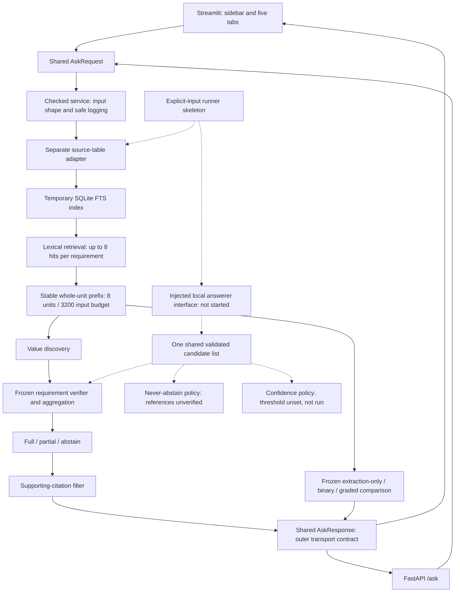

# Implemented architecture

This is a local engineering prototype. The broader hybrid RAG research design is
not established by the implemented lexical path. Explicit metric/year requirements
are supplied by the caller before retrieval and carried unchanged to all policies.

The diagram separates the normal lookup demo from the import-only research
skeleton. The runner has its own explicit source/retrieval preparation; dotted
arrows indicate interfaces, not an evaluation executed in this session. One
candidate list and packed snapshot feed all research policies. There is no
dataset loader, sampler, calibration routine, automatic model startup or scorer
in that skeleton. Empty/malformed generations remain failures in denominators.

## Boundaries

| Layer | Location | Responsibility |
|---|---|---|
| UI | `app/frontend/` | Sidebar cases/settings, source-cell links, decisions, comparison, explanation tabs |
| Transport | `app/contracts.py`, `app/checked_service.py` | Shared strict outer schema, malformed-grid errors, bounded-token audit, content-free logs |
| Orchestration | `app/service.py` | Existing adapter/retrieval/packing/policy wiring |
| Ingestion | `scripts/tatqa_excerpt_ingestion.py` | Preserve original cells, literal headers, metadata and unsupported content |
| Frozen core | `src/` | Retrieval, value discovery, verifier, contradiction policy, assessment and supporting citations |
| Packing/runtime | `app/runtime.py` | Whole-unit packing and optional fixed local model bridge |
| Runner skeleton | `app/evaluation_runner.py` | Explicit inputs and injected answerer; no real-data access or calibration |

The default lookup demo uses a conservative UTF-8 byte upper bound, explicitly
not exact model tokens. It reserves complete prompt space and never clips a
source unit to fit. A request that cannot fit without any evidence is rejected;
evidence truncation is shown, not hidden. The fixed local runtime can count actual
model tokens when explicitly authorized and running. It is off in this session.

The transport response wraps the frozen assessment rather than extending that
assessment's schema. Canonical rows bind literal metric/year/value cells only;
unsupported tables remain unverified or fail shape validation. No PDF table
parser, header repair, alias inference, unit conversion, dense/graph retriever or
general prose verifier is added. The submitted snapshot is not authenticated
issuer provenance. Retrieval can miss support or conflict, and whole-question
abstention on detected conflict remains unchanged.

Logs contain error codes, types and counts, not raw questions, cells, labels,
prompts or generated values. Temporary request databases are removed after use.
Local model assets and prepared samples remain ignored/uncommitted. No completed
labels, corpus or model files belong in the public building commits.
